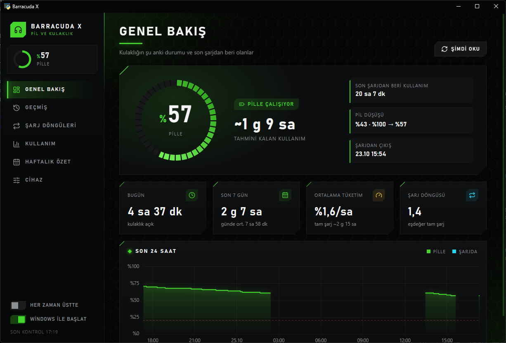
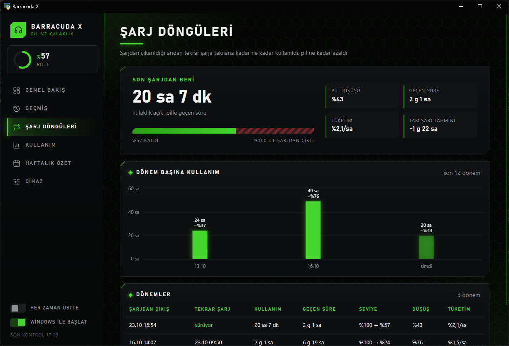
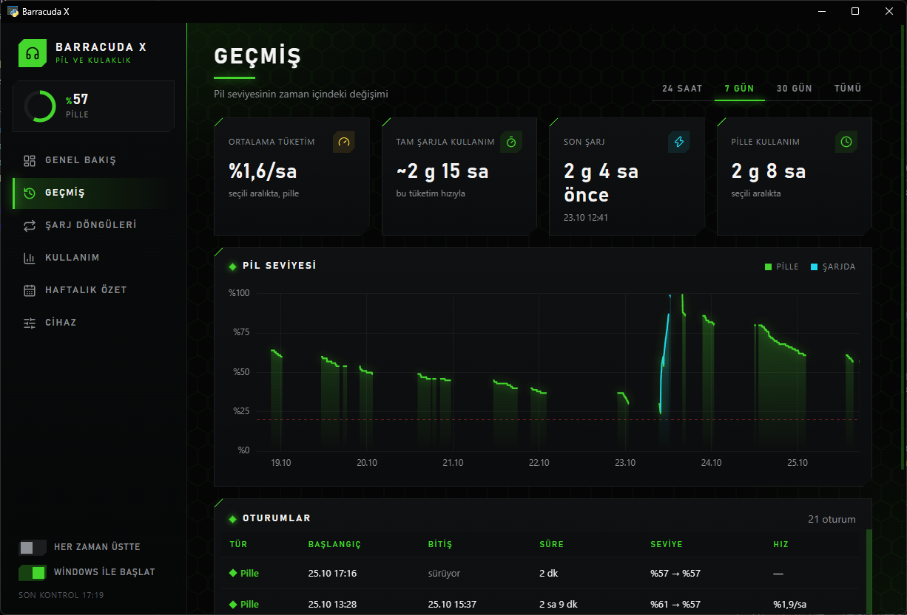
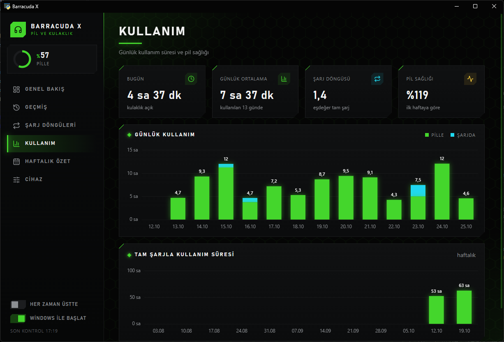
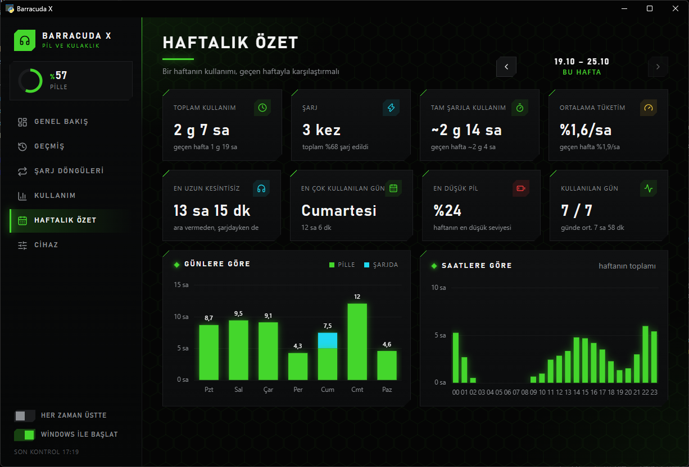
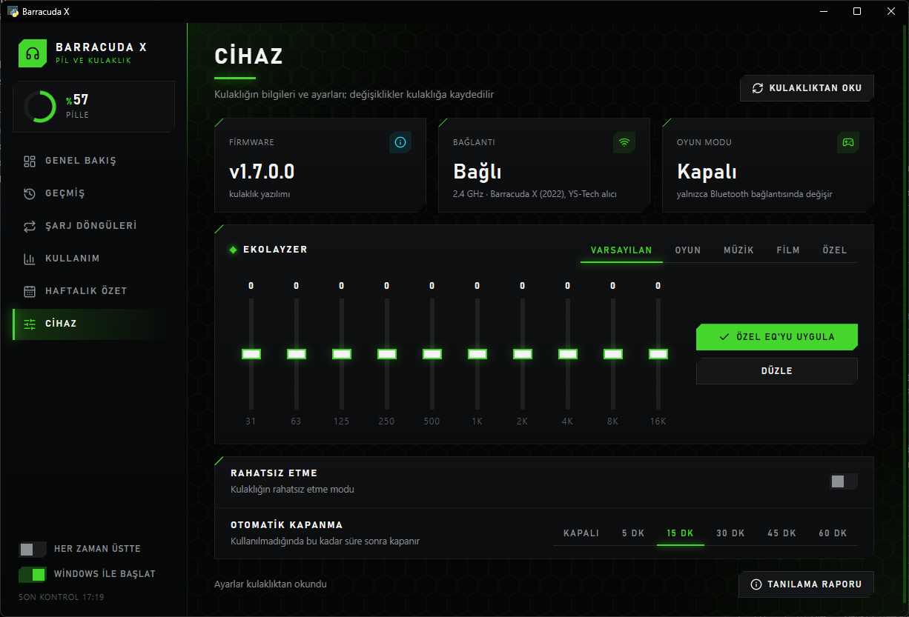

<div align="center">


# Barracuda X Battery

**Razer Barracuda X (2022) kulaklığın pil seviyesi, geçmişi ve ayarları, Windows'ta — Windows'un hiçbir şey göstermediği 2.4 GHz USB alıcı üzerinden.**

[](../../releases/latest)
[](#kurulum)
[](#geliştirme)
[](#nasıl-çalışır)
[](LICENSE)

[English](README.md) · **Türkçe**



</div>

---

Bluetooth'ta Windows, Barracuda X'in pilini gösterir. 2.4 GHz alıcıda ise hiçbir şey göstermez ve Razer'ın
masaüstü yazılımı bu kulaklığı hiç desteklemez: pil seviyesi, EQ ve otomatik kapanma yalnızca telefon uygulamasında.

Bu uygulama alıcıyla doğrudan HID üzerinden konuşur. Pil seviyesini bildirim alanında tutar, her dakika bir okuma
kaydeder, kayıtlardan geçmiş, şarj döngüleri ve kullanım istatistikleri çıkarır, kulaklığın ayarlarını bilgisayardan
değiştirir.

## Özellikler

<table>
<tr>
<td width="55%" valign="top">

**Bildirim alanında pil seviyesi.** Tepsi ikonu yüzdenin kendisi; şarjdayken renkli bir rozetin üstünde durur.
%20'de düşük pil bildirimi.

**Şarj anında görünür.** Kulaklık kablo ve pil değişikliklerini kendisi bildirir; uygulama bunları dinler ve bir
sonraki dakikalık okumayı beklemeden iki saniye içinde okur.

**Geçmiş.** 24 saat, 7 gün, 30 gün veya tüm zamanlar için pil seviyesi; şarj ve pil dönemleri ayrı renkte, her
oturum tabloda.

**Şarj döngüleri.** Şarjdan çıkarılıştan tekrar takılışa kadar: kaç saat kullanıldı, pil ne kadar azaldı ve bu
tempoyla tam şarj ne kadar yeter.

**Kullanım ve haftalık özet.** Günlük kullanım saatleri, pilin yıpranmasını gösteren haftalık tam şarj süresi,
eşdeğer tam şarj döngüsü ve geçen haftayla karşılaştırmalı haftalık sayfa.

**Kulaklık ayarları.** EQ ön ayarları, 10 bantlı özel EQ, rahatsız etme ve otomatik kapanma. Her değişiklik
kulaklıktan geri okunarak doğrulanır.

**Razer tarzı görünüm.** Siyah zemin, neon yeşil, köşesi kesik paneller, dar ve büyük harfli başlıklar ve segmentli
pil halkası; Razer donanımlarının yanında yadırganmaz.

</td>
<td width="45%" valign="top">



</td>
</tr>
</table>

### Ekranlar

| Geçmiş | Kullanım | Haftalık özet |
|---|---|---|
|  |  |  |
| Zaman içinde pil seviyesi, oturumlar, tüketim hızı, pille geçen süre. | Günlük saatler, haftalık tam şarj süresi, pil sağlığı. | Bir hafta, bir öncekiyle karşılaştırmalı. |

| Kulaklık ayarları | |
|---|---|
|  | Firmware, alıcı, EQ ön ayarları, 10 bantlı özel EQ, rahatsız etme ve otomatik kapanma. Her değişiklik kulaklıktan geri okunur; kabul edilmeyen ayar ekranda eski haline döner. |

## Kurulum

[Releases](../../releases/latest) sayfasından `BarracudaBattery-Setup-<sürüm>.exe` dosyasını indirip çalıştırın.

- Yönetici izni gerekmez. Kullanıcıya özel olarak `%LOCALAPPDATA%\Programs\BarracudaBattery` altına kurulur.
- Python gerekmez; çalışma ortamı içindedir.
- Pencere, Windows 11'de yerleşik olan Microsoft Edge WebView2'yi kullanır.
- Kurulum, çalışan eski bir kopyayı kapatır ve uygulamayı Windows ile başlatabilir (varsayılan olarak açık).
- 17 MB kurulum dosyası, kurulunca ~41 MB.

> **SmartScreen.** Kurulum dosyası kod imzalı değil; Windows ilk seferde uyarır: **Ek bilgi → Yine de çalıştır**.

Kaldırmak için Ayarlar → Uygulamalar. Kayıtlar `%LOCALAPPDATA%\BarracudaBattery` klasöründe kalır; onları da
silmek için klasörü silin.

## Desteklenen donanım

| Alıcı (USB kimliği) | Kulaklık | Durum |
|---|---|---|
| `1532:0550` (YS-Tech köprü) | Barracuda X (2022) | Test edildi: pil, kablo, olaylar, tüm ayarlar |
| `1532:0552` (Macronix köprü) | Barracuda X (2022) | Yayımlanmış protokol notlarından uygulandı; donanımda henüz doğrulanmadı |
| `1532:0536`, `1532:0574` | Barracuda X (2021), Barracuda X Chroma | Desteklenmiyor; uygulama alıcının adını verip bunu söyler |

Barracuda X (2022) iki alıcıdan biriyle gelir ve ikisi de kulaklığa aynı komutları taşır. Bluetooth'tayken alıcı
kulaklığa ulaşamaz; o durumda Windows'un kendi pil göstergesi işi görür.

Alıcınız `0552` ise ve bir şey çalışmıyorsa **Cihaz → Tanılama raporu** düğmesine basın ve kaydedilen
`tanilama.txt` dosyasını bir issue'ya ekleyin. Windows'un gördüğü HID arayüzlerini ve bir okumanın ham trafiğini
içerir.

## Nasıl çalışır

Alıcı, USB HID ile kulaklıktaki Airoha çipi arasında köprü kurar. Her konuşmada alıcı komutları kulaklığa iletecek
moda alınır (`E1 01`), Airoha komutları (`50 41 08 …`) gönderilir — pil yüzdesi `21`, kablo `2A`, EQ ön ayarı `13`,
özel EQ `15`, rahatsız etme `27`, otomatik kapanma `2C` — ve alıcı eski moduna döndürülür. Bir değer yazıldıktan
sonra geri okunur. İki alıcı sürümü yalnızca bu komutların etrafındaki HID çerçevesinde ayrılır:

| | YS-Tech (`0550`) | Macronix (`0552`) |
|---|---|---|
| Rapor kimliği | `02` | `01` |
| Giden | `02 80 uzunluk crc crc` + komut, CRC-16/XMODEM | `01 80 uzunluk` + komut, `01 40` el sıkışmasından sonra |
| Kabul | `GetInputReport`: `O` alındı, `F` meşgul | — |
| Gelen | `02 uzunluk` + çerçeveler | `01 80 uzunluk` + çerçeveler, bir çerçeve raporlara bölünebilir |

Uygulama tek programdan iki süreç olarak çalışır:

| Süreç | Görevi | Bellek |
|---|---|---|
| Tepsi (oturum açılışında `--tray`) | Her dakika ve kulaklık olaylarında okur, kaydeder, tepsi ikonu, bildirimler. Arayüz kütüphanesi yok. | ~33 MB özel |
| Pencere (`--ui`, tepsiden açılır) | WebView2'deki HTML sayfası: kayıtları okur, ayarları okur ve yazar. | ~73 MB + WebView2, yalnızca açıkken |

WebView2, penceresi gizliyken bile yaklaşık 300 MB tutar; bu yüzden pencereyi kapatmak onu gizlemez, süreci
sonlandırır. İki süreç alıcıya adlandırılmış bir mutex ile sırayla erişir; kayıtlar WAL modunda SQLite'tır, tepsi
yazar, pencere okur.

```
app.pyw            tepsi süreci, pencere süreci, sayfanın API'si
barracuda.py       alıcı çerçeveleri, kulaklık komutları, olay dinleyicisi, tanılama
history.py         kayıt, oturumlar, şarj döngüleri, günlük ve haftalık hesaplar
ui/
  index.html       sayfalar
  app.css          bileşenler ve Razer tarzı görünüm
  app.js           veri, grafikler (Chart.js), animasyonlar, ayarlar
installer/         Inno Setup betiği
build.ps1          testler, PyInstaller (klasör), kurulum
```

Kullanıcı verisi, hepsi `%LOCALAPPDATA%\BarracudaBattery` içinde:

- `history.db` — her okuma için bir satır (zaman, yüzde, şarj)
- `prefs.json` — "her zaman üstte"
- `tanilama.txt` — oluşturulduğunda tanılama raporu

## Geliştirme

```powershell
py -m pip install -r requirements-dev.txt
py app.pyw              # tepsi, ardından pencere
py app.pyw --ui         # yalnızca pencere
py barracuda.py         # bir okuma ve ayarlar, ekrana
py barracuda.py --diagnose
```

```powershell
py barracuda.py --selftest   # çerçeveler, çerçeve birleştirme, olaylar, değer kontrolleri
py history.py --selftest     # oturumlar, hızlar, şarj döngüleri, günlük/haftalık bölme
```

Testler kulaklık gerektirmez. Bir `0550` alıcıdan yakalanmış çerçeveleri ve leag'in protokol notlarındaki `0552`
örneklerini, biri iki rapora bölünmüş halde, yeniden oynatır.

### Derleme

```powershell
.\build.ps1
```

Testleri çalıştırır, uygulamayı PyInstaller ile `build\app` altına, ardından Inno Setup 6 ile kurulumu
`dist\BarracudaBattery-Setup-<sürüm>.exe` olarak derler. Sürüm numarası `installer\BarracudaBattery.iss` içinde.

PyInstaller klasör modunda çalışır: tek dosya derlemesi her açılışta kendini `%TEMP%` altına açar ve pencere süreci
pencere her açıldığında yeniden başlar.

## Sorun giderme

**"USB alıcı takılı değil"** — desteklenen bir alıcı takılı değil.

**"Bu alıcı desteklenmiyor: …"** — başka modelin Barracuda alıcısı takılı; yukarıdaki tabloya bakın.

**"Kulaklık kapalı, kapsama dışında veya Bluetooth modunda"** — alıcı yerinde ama kulaklık cevap vermiyor: kapalı,
uzakta ya da Bluetooth'a geçmiş.

**Oyun modu değiştirilemiyor.** Kulaklık komutu 2.4 GHz'de kabul ediyor ama uygulamıyor; bu ayar Bluetooth için.
Uygulama onu yalnızca gösterir.

## Katkı

Issue ve pull request'ler açıktır.

- Şu an en faydalı şey bir `0552` alıcıda test; tanılama raporunu ekleyin.
- Arayüz metinleri yalnızca Türkçe; `ui/index.html` ve `ui/app.js` içinde.
- PR açmadan önce iki testi de çalıştırın; `build.ps1` hata varken derlemez.

## Teşekkür

Alıcı çerçeveleri ve kulaklık komutları şu projelerin yayımladığı çalışmalardan gelir:
[mehdibouchami/razer-barracuda-x-battery](https://github.com/mehdibouchami/razer-barracuda-x-battery),
[KhromotozzDevOut/razer-barracuda-battery-tray](https://github.com/KhromotozzDevOut/razer-barracuda-battery-tray) ve
[leag/razer-barracuda](https://github.com/leag/razer-barracuda). Onlardan kod alınmadı.

## Lisans

Projenin kendi kodu için [MIT](LICENSE). Dağıtılan derleme, kendi koşullarıyla üçüncü taraf bileşenler içerir;
bkz. [THIRD-PARTY-NOTICES.md](THIRD-PARTY-NOTICES.md).

Razer ve Barracuda, Razer Inc.'in ticari markalarıdır. Bu proje Razer ile bağlantılı değildir, Razer tarafından
onaylanmamış veya desteklenmemiştir.

---

<div align="center">

[nightdijital](https://nightdijital.com) · [iletisim@nightdijital.com](mailto:iletisim@nightdijital.com)

</div>
